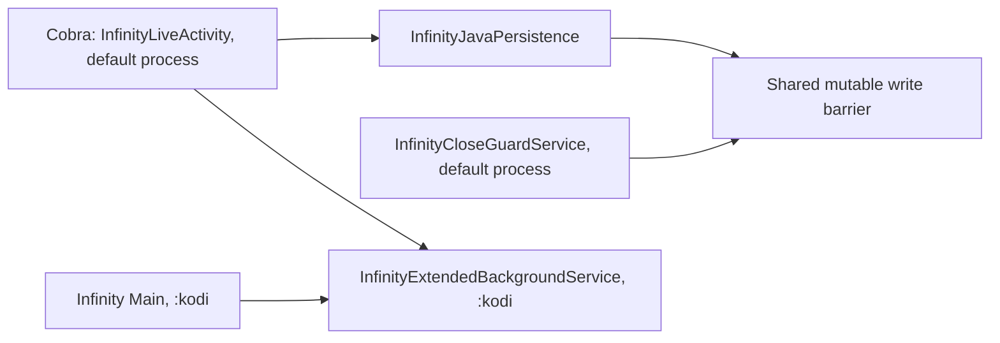

# Isolation implementation checkpoint

**IMPLEMENTING_AUTHORIZED_LIFECYCLE_CORRECTION. No signed candidate yet.**

The subsequent user authorization in [SCOPED-CORRECTION-AUTHORIZATION.json](SCOPED-CORRECTION-AUTHORIZATION.json)
permits the two necessary lifecycle corrections. Codex is implementing them on
this same branch. The protected lock and accepted registry remain unchanged.

Production persistence/barrier and background definitions are cloned from the
verified signed DEX. Owner-specific queues, wrappers, locks, mini-player state,
notification identities and settings snapshots now compile. A narrow combined
durability adapter keeps the original receipts and final native checks; it never
terminates a process retained by Cobra. The initial module writer preserved all
8,834 untouched original class definitions exactly. Fourteen host contract cases
and eight focused tests using translated production DEX passed; see the
[source-bound checkpoint receipt](results/scoped-correction/LIFECYCLE-CHECKPOINT.json).
These are scoped host checks, not device acceptance or a completed release.

Remaining implementation includes the complete ownership/cross-call map,
reminder entry retention validation, final owner-module assembly and independent
combination controls, and the original-key signing gate. The old blocked run
below remains valid historical evidence; it has not been relabeled successful.

## Prior checkpoint (before lifecycle authorization)

[GitHub Actions run 40429181073](https://github.com/mahfouzhassine8-ops/project-infinity/actions/runs/40429181073)
reproduced the inventory and registry exactly, passed all 13 host tests and the
actual APK negative controls, then failed at the hard gate with
`UNRESOLVED_RELEASE_BLOCKERS`. Original-key signing and signed-APK upload were
skipped. The run's real conclusion is **failure**, as required for a blocked
release; the receipt is [CI-40429181073.json](results/CI-40429181073.json).

Codex implemented the actual-binary inventory, initial component fingerprint
partitions, baseline accepted registry, deterministic preservation assembler,
pre-sign gate, controlled negative tests, and combined-release workflow. This is
an executable foundation, **not completed runtime isolation**. The component
directories are fingerprint partitions; they are not independent compiled
feature modules. Do not deliver the unsigned review APK to the user.

The accepted app remains signed Infinity 2103420 from build 40413893227, source
`ddc054583c5e5f3cd04c328e131cb76af8d4728b`. Its SHA256 is
`ae641e74bbe0b3360d103254d9bc5425fe1558f625466a99f1da9f16414fef26`.
The protected lock remains `883c64a4de6f87077893921454de71bba850235b`.
No application source, native implementation, user data, process declaration,
shutdown routine or original-key material was changed.

## Exact scope blockers

The instructions in [AGENTS.md](../../AGENTS.md) say:

> If a protected shared-lifecycle edit is necessary, stop that particular change
> and report it, do not assume permission.

The [governing brief](ASTRA-PRO-MASTER-IMPLEMENTATION-BRIEF-20261026.md) also says:

> If a proposed process or manifest change would alter shutdown dependencies,
> stop that part and record the exact conflict.

The actual signed DEX proves two conflicts. Exact class/method hashes and
selected instructions are in [BLOCKER-PROOF.json](BLOCKER-PROOF.json).

1. `InfinityLiveActivity.onCreate/onResume` (Cobra, default process) calls
   `InfinityJavaPersistence.userEntry`. That calls
   `InfinityJavaWriteBarrier.userEntry`, which resets static `closing`, `session`
   and `seal`. `InfinityCloseGuardService` (also default process) uses this same
   barrier in `onStartCommand`, `acceptSafe`, and its authorization checks.
   Cobra persistence and work also register with this barrier. Copying only the
   persistence class would retain shared accounting; redirecting the barrier
   would change which Cobra writes Infinity's frozen close observes.
2. Cobra calls `InfinityExtendedBackgroundService.startMiniPlayback`,
   `refreshMiniPlayback`, `stopMiniPlayback`, `setEnabled`, and `sync`. That
   service is declared in `:kodi` and is also used by `Main`. It owns static
   mini-player references and reads/writes `infinity_runtime/extended_background`.
   Moving Cobra into `:cobra` would alter the static callback/IPC relationship.
   Splitting the service or settings would change protected shared behavior.

The safe continuation is an explicit, bounded lifecycle scope decision covering
these persistence and background-service contracts, followed by a reviewed
ownership split preserving authenticated writes and close accounting. Neither a
second package nor a speculative process relocation solves these conflicts.
No protected edits were attempted. No new shutdown test was run.

## What is implemented and verified

- [OWNERSHIP-MAP.json](evidence/OWNERSHIP-MAP.json) inventories all 7,604 APK entries,
  with content hashes and source/build provenance. Compressed JSON shards contain
  all 8,860 DEX classes, 64,143 methods, 332,093 call/field references and 71,500 edges
  that cross owners or involve unresolved ownership. All six supplied component
  ZIPs were checked byte-for-byte against their APK members.
- DEX fingerprints come from pinned baksmali 2.5.2 with symbolic references and
  sequential labels. Class fingerprints include methods, fields, annotations,
  and initial values. Renumbering a DEX index cannot hide a changed reference.
- [modules](modules) and [accepted-combined-release.json](accepted-combined-release.json)
  store actual member/class fingerprints. Infinity's version is 2103420; Cobra's
  initial internal label explicitly means the implementation bundled in 2103420.
  The registry does not assert that every shared function has been assigned.
- [release_gate.py](release_gate.py) checks actual packaged class/member hashes,
  one original launcher, package identity, version progression, component
  digests, registry generation and remote authority HEAD before signing.
  Unknown members, stale owner bytes, registry races and unresolved ownership
  fail closed. [assemble.py](assemble.py) repeats the gate, verifies the staged
  bytes and current authority, then and only then reads the original key.
- The assembler preserves all 7,600 non-signature payload entries other than the
  typed manifest version. Its unsigned review version 2103421 is only a build
  control. Runtime behavior is unchanged and isolation is still blocked.
- Thirteen synthetic host tests passed, including consecutive independent-owner
  approval fixtures, both stale-side directions, cross-owner writes, settings,
  manifest/chooser changes, missing members and registry races. These are
  **synthetic registry fixtures**, not two independently developed feature builds.
- Actual unsigned APK controls rejected a valid DEX modification to
  `infinity_cobra_live` and an Infinity Search Python modification. The DEX string
  is used by Cobra and chooser classes, demonstrating another shared data edge.
  The unchanged-runtime candidate was also refused because blockers remain.
- Direct `apksigner` verification passed v1/v2/v3 and confirmed the original
  certificate `d7adeb68e9341596a02bd3262b737a0f45fc6e771ed7e60285437e833b58c6d7`.

## Production gate and remaining limits

The [combined workflow](../../.github/workflows/infinity-combined-release.yml)
reconstructs this inventory and registry, executes the selected host/actual-APK
controls, and invokes the hard gate before the original-key signing step. With
the current registry the **gate is expected to fail and signing must be skipped**.
There is no `continue-on-error`, automatic approval, device installation, shutdown
runner, final lock or accepted-pointer update.

The canonical authority is the dedicated implementation branch. The workflow
serializes its signing jobs and uses optimistic HEAD checks before/after audit
and signing. This protects this new combined-release path; it does not retire
historical signing workflows, secure credentials against repository admins, or
prevent an arbitrary external installer. Central retirement/authorization of
legacy release paths and a reviewed approval/promotion mechanism remain needed
before claiming repository-wide release enforcement. The current bootstrap can
only reproduce the already accepted 2103420 registry and refuses overwrites.

3,698 DEX classes remain conservatively unresolved. Native function/JNI ownership,
dynamic Python call/state paths, shared presentation and complete persistent-key
ownership are unfinished. Whole native/asset bytes are pinned, but that is not a
completed native function graph. All cross-owner edges remain review candidates;
no shared mutable implementation has been relabeled as a harmless platform API.

No application smoke test, install-over durability test or physical Fold check
has run. There is no claim of independently isolated runtime modules, completed
engineering acceptance, or a new signed APK ready for the Fold.

## Reproduction

Use the exact baseline artifact 12695160919 and DEX-tools artifact 12464327386.
The workflow supplies the artifact paths and commands. Locally, the sequence is:

1. `inventory.py` with the original APK, six components and pinned jars into a
   fresh working directory; compare its output with `evidence/`.
2. `bootstrap_registry.py` into a fresh output directory; compare the registry
   and module manifests with the checked-in baseline.
3. `python3 -m unittest -v test_release_gate` with this directory on `PYTHONPATH`.
4. `verify_baseline.py`, then `assemble.py prepare`, then `test_actual_apk.py`.
5. `release_gate.py` on the unsigned review APK and current remote HEAD. Expect
   `SIGNING REFUSED: UNRESOLVED_RELEASE_BLOCKERS`; never convert it into approval.

The full command arguments and selected test authority are in the workflow and
[TEST-SCOPE.json](TEST-SCOPE.json). Local reports are in `results/`.
