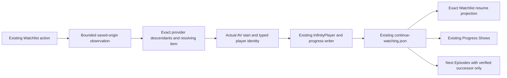

# Infinity Watchlist playback — Phase A findings and conditional design

Phase A is complete as a source investigation and design review. Production source
is unchanged. This is not an implementation-ready approval: exact saved-origin
lineage and a supported complete episode-catalogue contract remain design gates.
No application tests, implementation, build, signing or installation ran.

Codex led integration; Astra (`gpt-6-astra`) traced and independently audited the
architecture; GPT-6.1 (`gpt-6.1-sol`) prepared the scoped implementation design.

## Protected baseline and boundaries

Protected ref: `locks/infinity-2103466-owner-approved-base-20261108`, commit
`5ee1c7ae0bbe295c311aa34c02f6b62688ccb5a7`. The retained original-signed APK is
2103466, SHA-256 `d366e4b8aadba8484768cfcc0d362c2fc8e0181d78123ea77e04af4f028a3135`.
Its bundled Infinity is2103466, Cobra2103445, Command Center0.3.5.64,
Trakt sync1.2.8.1 and skin1.0.5.270. These are APK component identities, not a
fresh inventory of active external add-ons on the Fold. All79 declared packaged
module files match the manifest. Existing original-key signing evidence is reused.
`BASELINE.json` and `SOURCE-MAP.json` bind the inspected source.

The owner's new baseline approval and working Spider-Man Umbrella Movie Search
are recorded. They do not clear the separate automated Search release gates.
The Search/Silent Mode work branch, artifacts, recovery and evidence stay separate.
The earlier10:09 Fold identity report identified464 and is not relabeled as466.
No repeat of those four source exports or identity collection is requested here.

Initial implementation scope is the explicitly requested Infinity Movies/TV
Watchlist flow, including provider show/season descendants selected from it.
Collection, Save for Later, custom lists and Continue Playing retain existing
behavior unless separately included in an approved implementation scope. No new
Watchlist UI, menu, list, tracking store or external Trakt synchronization is planned.

Locked flow: Search → long press → Infinity Trakt → Add to Watchlist → Infinity
Movies/TV → Watchlist. Saving, removing, displaying, selecting and folder browsing
retain their behavior. Saving alone never creates progress. Regular Movies/TV
playback, including an ordinary launch of the very same saved title, must retain
baseline behavior. Cobra, providers, Search, authentication, user data and settings
remain protected.

## Exact source trace and confirmed gaps

Python paths below are APK members under
`assets/addons/script.infinity.commandcenter/`; line numbers refer to the exact
extracted2103466 files. Native files match the retained466 ARM64 source map.

| Boundary | Exact functions and lines | Finding |
| --- | --- | --- |
| Save/retrieve | `infinity_trakt.py:selected:76`, `set_membership:111`, `apply_local:127`; `plugin.py:_values_for:669`, `listing:697` | Existing local list membership and immutable saved snapshot are already separate from playback progress. Movie/episode actions also use the existing WatchedBridge controller. |
| Saved row → play | `plugin.py:show_item_menu:424`, play branch527–548; `_list_item:588`, in-progress600, offsets652–662 | Watchlist rows use the saved snapshot's position. A title saved before playing can still emit StartOffset0 even when its current progress exists in `items`. This is a source-proven resume projection gap. |
| Actual playback recorder | `service.py:InfinityPlayer.onAVStarted:746`, `_arm_continue:824`, `_continue_player_item:496`, `_continue_identity:597`, `persist_continue:849`; stop776/end784/error792 | The player recorder and persistence connection already exist. Source inspection does not prove a generic failure to record movies. No replacement recorder is justified. |
| Existing progress | `resume_hub.py:progress_key:698`, `record_progress:707`, `_resume_identity:608`, `_entries_projection:876`, `progress_shows:941` | Playback updates `items`; Watchlist snapshots are not joined to it. Existing exact identity/alias protections must remain. |
| Playback proof compatibility | `experience.py:CURRENT_SOURCE_CONTRACTS:66`, `_source_contract:84`, `source_identity:126`; `service.py:643–652` | Playback proof recognizes older Umbrella6.7.94/POV6.10.20 plus older bridge versions, not owner6.8.00/6.11.02. Search compatibility does not grant playback proof. Typed raw progress can still be recorded, but verified series/source enrichment is withheld. |
| Legacy episode proof | `infinity_modules/watchedbridge/provider_contracts.py:canonical:44`, `presentation:57`; `controller.py:147–162`; `resume_hub.py:same_identity:193` | Saved raw episode scope and producer-reviewed show/episode scope can differ. Existing proof records support a conditional canonical view; globally relaxing identity equality would be unsafe. This mismatch is conditional on an admitted producer, not a claim that the current Fold versions pass that admission. |
| Saved origin | `xbmc/guilib/InfinitySavedNavigation.h:Begin:67`, `WindowResult:253`; `InfinitySavedNavigationState.h:Correlation::Finish:60` | Existing success clears the navigation ticket. A successful show folder does not propagate saved origin through subsequent season/episode selections. Membership, matching titles or a stale Home property cannot prove the click origin. |
| Actual resolver item | `xbmc/filesystem/PluginDirectory.cpp:GetPluginResult:151`, capture177–183; `xbmc/interfaces/json-rpc/PlayerOperations.cpp:GetItem`, export297–306 | Existing original provider provenance belongs to the actual CFileItem, but does not prove saved-list origin. Existing `GUIMediaWindow.cpp` hooks at962/1034 provide observation points; no change to that GUI file is currently proposed. |
| Next Episodes | `service.py:_continue_show_identity:514–594`; `resume_hub.py:next_episodes:963`, proof994–1009 | A local Kodi library can prove the successor. Nonlibrary provider browsing has no complete successor receipt. Filtered directories, next-visible rows and E+1 cannot establish the next episode or season transition. |

The missing link is therefore a combination of current saved-row progress
projection, trustworthy saved-launch identity/provenance, and verified successor
evidence. It is not a missing database or a missing player callback.

## Minimal proposed correction — requires Phase B authorization

Use the existing pipeline:

Seven existing production files are a proposed scope ceiling, with at most one
small authenticated Command Center helper if needed. All changes would be
compared against the protected466 sources. Extra files require a revised review.

| Proposed file | Narrow responsibility |
| --- | --- |
| `xbmc/guilib/InfinitySavedNavigationState.h` | Bounded transient saved-origin observation alongside existing recovery correlation, without changing recovery ticket completion. No durable tracker. |
| `xbmc/guilib/InfinitySavedNavigation.h` | Observe the actual first-party Watchlist selection at `Begin`; correlate exact directory descendants through `WindowResult` and their selected item generation. |
| `xbmc/filesystem/PluginDirectory.cpp` | Carry that observation on the same actual resolving CFileItem at the existing original-provider capture. Preserve provider success/results/metadata. |
| `xbmc/interfaces/json-rpc/PlayerOperations.cpp` | Export bounded provenance for that exact active video item, under the existing Infinity-only boundary. |
| `service.py` | Validate the saved row, receipt, current producer source contract, actual typed identity and exact episode coordinates at existing `_arm_continue`/`_continue_identity`. Enrich only admitted Watchlist-origin playback. |
| `resume_hub.py` | Exact playable saved-row progress selector and opt-in progress-only identity view. Any affected `progress_key`/`record_progress` comparison must be explicitly scoped to admitted saved playback; ordinary callers retain their exact baseline path. |
| `plugin.py` | Read current effective progress for Watchlist `_list_item`, explicit Play, Information/Resume and recovery offset, preserving the original saved row/key/route/membership and folder behavior. |

The native proposal is an observation seam necessitated by the missing strict
origin chain. It is not authorized in Phase A. Do not edit native player logic,
`ApplicationPlayerCallback`, `SaveFileStateJob`, graphics, GUI locks, lifecycle,
checkpoint/shutdown implementation, provider code or Cobra. A source-proven Python
handoff with equivalent exact-item lineage could replace the native seam; none
was established. Do not promise an add-on-only solution before that proof exists.

Lineage must bind the selected item's parent navigation generation, successful
child directory result, subsequent selected descendant, resolver invocation and
actual active item. Define traversal/memory/lifetime bounds before implementation;
no magic fixed limits are approved by this design. Invalidate on cancellation,
unrelated navigation/selection, replacement, profile/experience change and stale
results. Test cached rows, same-path revisits and consecutive episodes sharing a
stream URL. A matching URL or copied ListItem property alone is insufficient.
No persistence or progress occurs while observing directories or resolution.

The resume projection must match an exact movie or exact episode, not the newest
episode of a show. `_menu_resume` cannot be reused unchanged because it uses
series-collapsed entries and series matching. Use fresh visible progress and
revision ordering, reject conflicting IDs/nonfinite offsets, respect hidden and
completed entries, and recheck on explicit playback dispatch. Direct Watchlist
click currently returns a raw provider URL, so a new fresh Python dispatch does
not already exist. The origin/launch contract must specify how a direct click
revalidates current offsets (for example, a reviewed Watchlist-only first-party
dispatch within existing plugin.py that forwards the unchanged provider route).
Render-time offset copying or popup-only rechecking is insufficient. No such
new dispatch is implemented or presumed proven by this plan. Keep original
saved identity/key/routes/membership byte-for-byte in the store. A completed title
replays from zero. Show and season rows remain directories.

Any legacy proof canonicalization is opt-in for this saved-flow comparison only.
It must validate the existing proof's identity/provider/scope and preserve raw
saved records and WatchedBridge/manual-action semantics. Do not globally change
`same_identity`, `_resume_identity`, provider contracts or ordinary progress keys.

Retain the single `continue-watching.json` schema2 store, existing admitted atomic
writer, occurrence IDs, hidden markers, unknown fields and publication revision.
New partial progress still requires duration≥120s, position≥30s AND≥1%; existing
rows retain their original rewind/update rules. Sampling stays8s. Completion
stays≥95% or playback-ended; duplicate completion is suppressed per occurrence.
An unfinished episode may remain the current item under the existing Next
Episodes projection; advancement to a different episode requires the existing
watched completion rule and verified successor evidence. Clock loss on stop/error
retains the last authoritative sample. Playback failures
before AV start, browsing and saving cannot create history. No provider database
or Trakt account write is introduced.

## Dependency gates and regression risks

1. **Current producer evidence.** POV's complete export supports exact emitter
review. Umbrella's supplied export contains five Search-target files and excludes
`episodes.py`/`control.py`. Public6.8.00 source can guide review but is not proof
of those installed bytes. A saved-only adapter must verify exact emitter code
and actual playing ID semantics using existing Kodi access before admission;
no older provider substitution or global playback-contract bump. Reuse all
already supplied evidence; no repeat full export is requested in Phase A.
2. **Exact origin protocol.** The four native observation edits are a candidate
boundary, not proof that an implementation safely handles all selected/cached/
playlist routes. Specify and audit the selected-item protocol first. A mere
saved-membership filter is rejected because it changes ordinary playback of the
same saved title.
3. **Successor catalogue.** No supported complete nonlibrary catalogue contract
has been identified. TMDb Helper is not bundled in the retained APK; its actual
installed interface/version must not be assumed from old QA fixtures. Review a
supported existing metadata boundary with verified show IDs, current-episode
membership, complete ordering, season boundaries, specials and availability
before implementing advancement. Provider listings can be filtered. Never trust
an advertised next-episode field without source review or infer E+1.
4. **No player callback network work.** Obtain any catalogue snapshot only at a
reviewed explicit navigation/launch boundary using existing supported access.
No new metadata service/timer or new blocking metadata/network/RPC work in
player callbacks; retain baseline Player.GetItem and checked local-library identity
JSON-RPC. No RPC/network work under native correlation locks. Failure must not delay or change baseline playback.
Without valid successor proof, preserve real progress and withhold successor;
that safe fallback does not satisfy completed-to-next acceptance.
5. **Isolation and alias risk.** Scope canonicalization to admitted Watchlist
playback; test an ordinary launch of the same title as a negative control.
Preserve regular Movies/TV, manual watched actions, hidden state, retained
history, pending library sync, all providers and Cobra. No profile migration,
credential access, settings alteration or database operation is planned.

If a catalogue/provenance gate needs more production files or another dependency,
revise this plan for owner review before implementation. Do not ship a partial
feature as complete.

## Verification and next authorization boundary

`TEST-PLAN.md` specifies focused cases for Phase B. None were executed here.
Astra's independent audit accepts this only as a conditional Phase A design;
`ARCHITECTURE-AUDIT.md` records the qualifications. Source hashes and a documentation-
only diff establish Phase A preservation; they do not prove feature behavior.

The owner's handoff explicitly reserves source modification, integration and
focused tests for Phase B after architectural review. Approval must name the
saved-only scope and proposed native observation purpose. Close the origin and
catalogue contracts before production edits. No APK rebuild/signing can begin
merely because this investigation is complete. After authorized implementation
passes, use the permanent original-key workflow, current release-version
registry and matching forward recovery; do not hardcode/reuse an issued version.

Final Fold acceptance remains the owner's single end-to-end test after focused
engineering verification. Baseline approval is not substituted for that feature
acceptance or for independent Search release clearance.
